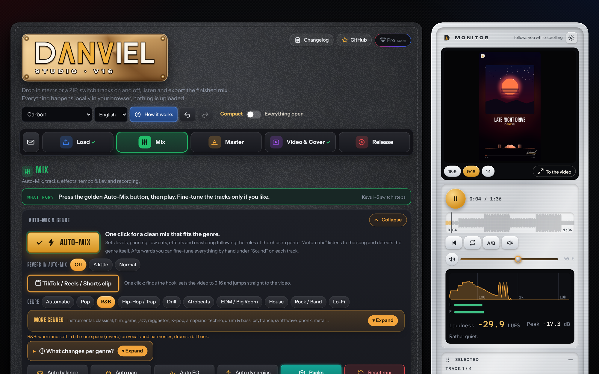
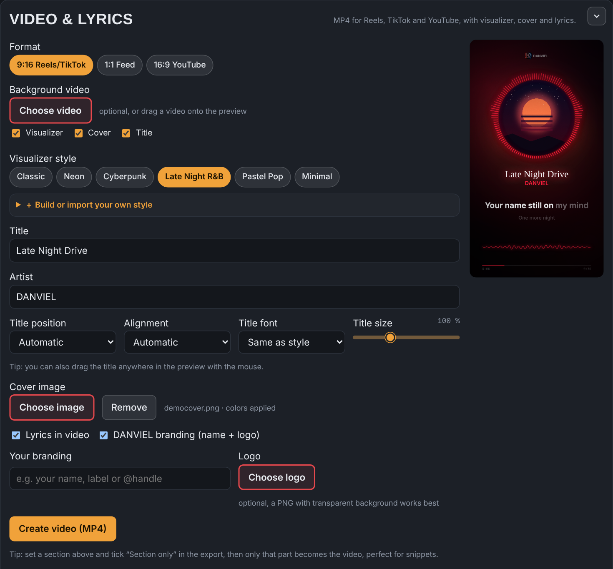
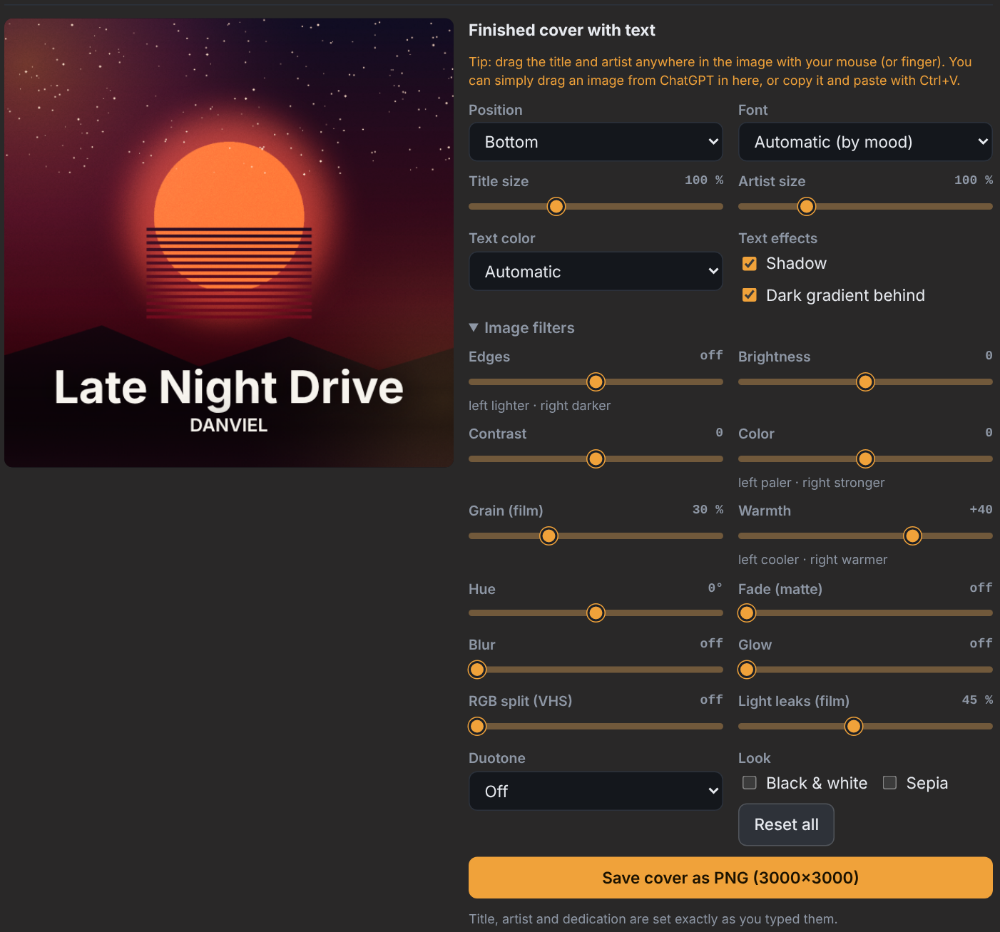
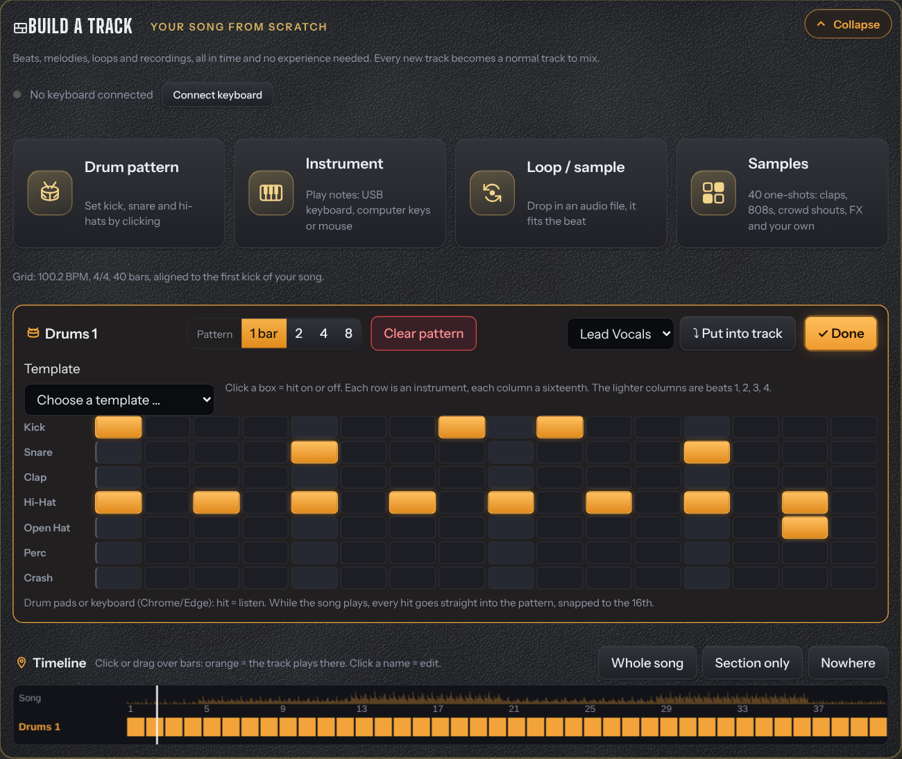
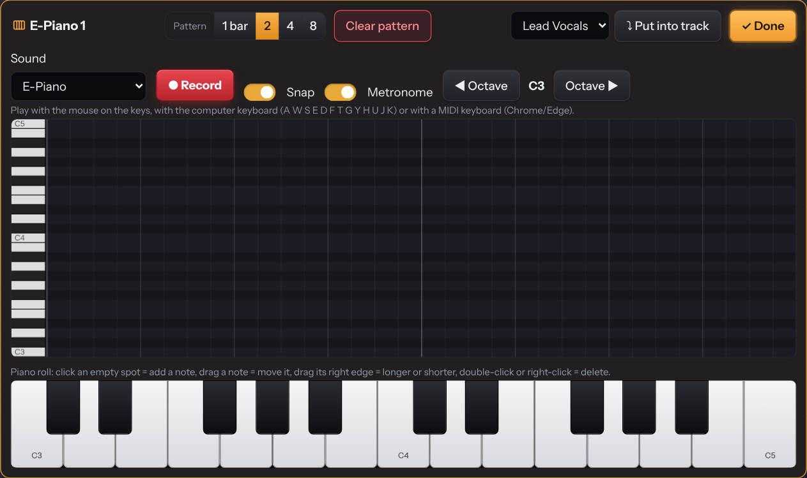
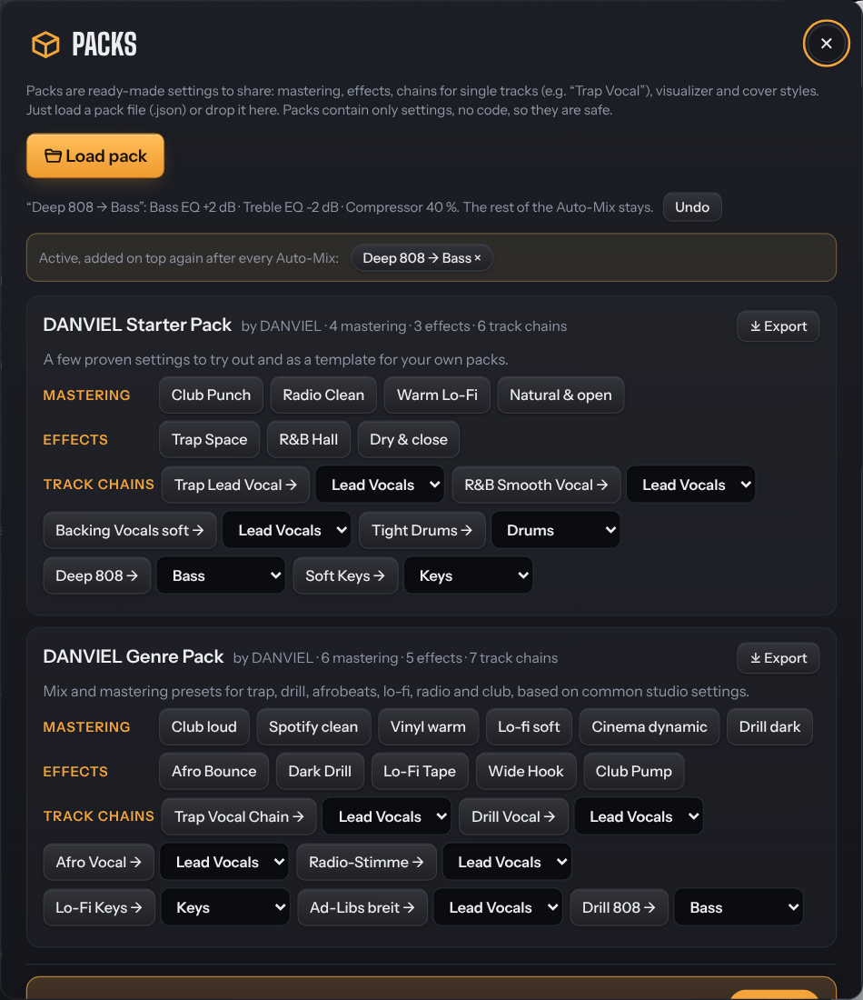
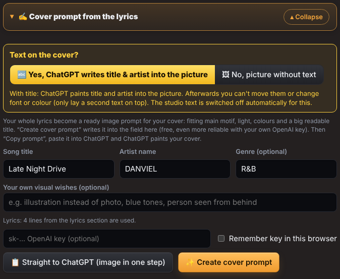
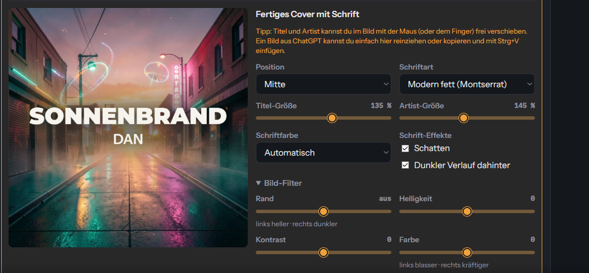
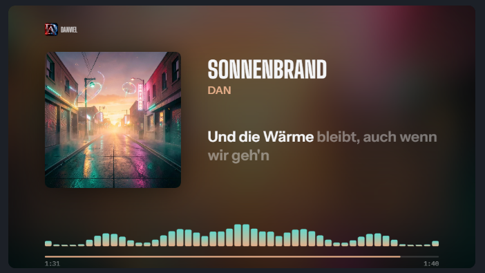
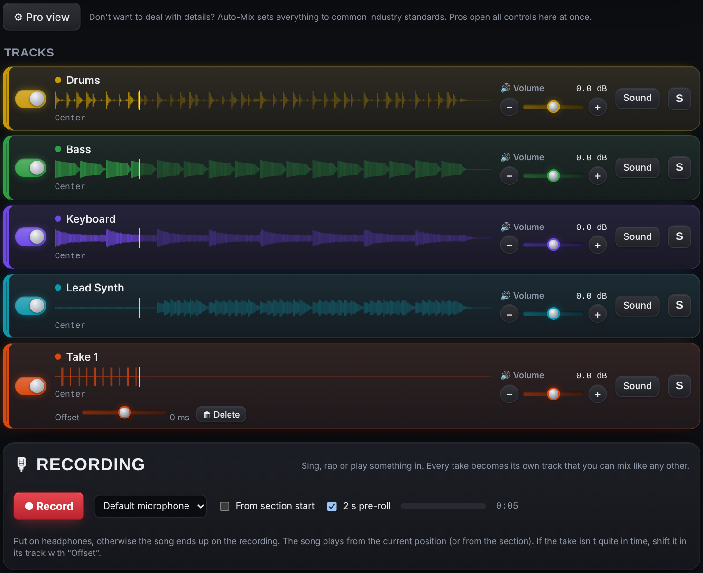

# DANVIEL Studio

**Free music studio in your browser:** mix stems, master your song, make lyric videos and covers, and get everything ready for release. **Or build a beat from scratch:** drum patterns by clicking, play melodies with your computer keys or a USB keyboard, drum in with pads, add loops and arrange it all on a timeline, then record your vocals over it. No installation, no upload: your songs stay on your computer.

**▶ Open the app:** https://0zoon.github.io/danviel-studio/

⭐ **If you like it, star this repo** – it helps other musicians find it.

[](https://0zoon.github.io/danviel-studio/)

| Videos for TikTok, Reels & YouTube | Cover studio |
|---|---|
| [](https://0zoon.github.io/danviel-studio/) | [](https://0zoon.github.io/danviel-studio/) |
| **🧱 Build tracks: beat, melody, loops** | **🎹 Play in with a keyboard or drum pads** |
| [](https://0zoon.github.io/danviel-studio/) | [](https://0zoon.github.io/danviel-studio/) |
| **📦 Packs: presets to share** | **Cover prompt from your lyrics** |
| [](https://0zoon.github.io/danviel-studio/) | [](https://0zoon.github.io/danviel-studio/) |

## Made with DANVIEL Studio
Real song, real workflow: stems split with the built-in AI, lyrics taken over from the Suno archive, cover finished in the cover studio and a YouTube video with lyrics and visualizer.

| Cover studio | 16:9 video with lyrics |
|---|---|
|  |  |

## 🔒 New in v17
- **No connection to Google or font services:** all fonts and the MP3 encoder are hosted right here, better for privacy and faster
- **Works offline:** open it once on the website and it starts without internet too, fonts included
- **Choose the sample rate** for the export (original, 44.1 kHz or 48 kHz) with the true peak held, and **dither on 16-bit WAV**
- **Own Auto-Mix genres:** build your own from any genre, or save your fine-tuned Auto-Mix as a genre, export and import as .json
- **Video preview with the keyboard:** Tab in, N picks cover, title, lyrics or visualizer, arrows move, + / − resize. Better labels for screen readers
- [Privacy & legal notice](https://0zoon.github.io/danviel-studio/privacy.html), source code in modules and an automatic test on every update

## 🔤 New in v16.5
- **Font menu with live preview:** your title in every font, hover to see it on the cover, a click takes it; groups, search, favourites and 26 new fonts (over 75 now)
- **Full-screen videos your way:** move and resize the visualizer and lyrics right in the preview
- **Karaoke lyrics stop with the lead vocal** instead of running into the instrumental, or switch the sweep off
- Bigger cover without lyrics, DANVIEL in the logo look, the style builder starts from the style you picked, “Add picture” where you need it

## 🥁 New in v16.4
- **15 demo songs** instead of short loops: intro, verse, hook, break and outro, about 1 to 1.5 minutes each, as separate stems. New: afrobeats, amapiano, phonk, dancehall, synthwave and boom bap
- **Samples:** 40 one-shots made in the studio (drums, 808s, crowd shouts, hits, FX, atmo), straight into the drum pattern, plus your own samples
- **Full-screen picture in videos:** your image corner to corner with a slow zoom, title, visualizer and lyrics on or off with one click
- **10 new backgrounds** and a completely new “How it works” with golden numbers, monitor and samples

## 🎹 New in v16.3
- **Packs go on top of Auto-Mix:** “Deep 808” adds sub to the bass without resetting anything else; loudness and balance stay, every change is listed with an undo, and active packs are re-applied after each new Auto-Mix
- **Plug in a keyboard and play:** USB keyboards are detected anywhere in the studio, with velocity, sustain pedal, pitch bend and start/stop recording (Chrome/Edge)
- **Drum pads:** pads like Akai MPD play the drum pattern, and while the song runs every hit is written into the grid on the nearest 16th
- **Save project takes everything:** cover drafts, the finished cover with text, lyrics, background video and your finished videos
- **Cleaner track list:** switched-off MIDI tracks are hidden until you click “Show MIDI”
- **7 new video styles** (DANVIEL Gold, Rainy night, Ice, Sunset, Embers, Vaporwave, Old film), **6 new effects** (rain, snow, embers, light leak, bokeh, dust), new backgrounds and cover styles; the visualizer always ends above the signature
- **Own icons everywhere** instead of emojis, and switches for on/off options

## 🎚 New in v16.2
- **17 new Auto-Mix genres:** drill, afrobeats and lo-fi in the first row; instrumental, classical, jazz, reggaeton / Latin, K-pop, amapiano, gospel, country, techno, drum & bass, psytrance / Goa, synthwave / cyberpunk, phonk and metal under “More genres”, each set up the way studios usually mix them
- **New DANVIEL genre pack** (mastering, effects, track chains) and **export** for every pack
- **Delete project** also at the bottom right of the monitor, always with an “are you sure?” window

## 🎛 New in v16.1
- **Monitor upgraded:** whole-mix waveform to click and seek, keys for start, loop, before/after and mute
- **Building blocks:** selected track, track overview, big visualizer and quick select can be hidden and dragged; video and player always stay
- **Four monitor designs:** stainless steel, chrome, black glass, leather
- **MIDI stays off** on quick select, wider folder on big screens, own icons instead of emojis, Auto-Mix report folds after 10 s

## 🎛 New in v16
- **New design, dark by default:** charcoal cards with gold on the leather folder (“☀ Light” background for the bright look)
- **The monitor:** on wide screens a stainless steel tray on the right follows you while scrolling: big live video preview, the player with loudness, peak and analyzer, and “Selected” with the main controls of the track you touched last
- **Wide step bar** with its own icons, **info cards on hover**, undo/redo as arrows, “Compact / Everything open” as a switch
- **Project bar at the bottom:** save, open and the red delete button
- **Auto-Mix in gold, packs in teal**, auto tools and quick tweaks in one even grid with their own icons
- **Fixes:** track waveforms stayed empty after switching steps; video signature smaller in the corner

## ✨ New in v15.8
- **New logo:** “DΛNVIEL” built from its own letters, Λ, N and V form a golden sound wave, plus a new app icon (D with a golden peak)
- **Branding in the video:** the DANVIEL mark top left and the signature “Danviel Studio” bottom right, the whole video long. With your own logo or name the mark moves to the top right
- **Keyboard shortcuts:** A = Auto-Mix, M = mastering on/off, B = before/after, L = load files, V = create video, E = export, ? = all shortcuts. The keyboard button in the step bar lists them all
- **Step bar with its own icons** instead of numbers
- **Colour pickers** with swatch, hex code and 12 ready colours, checkbox groups in a neat grid, red delete/reset buttons, buttons in one row share one height
- **Folding tracks fixed:** collapse all tracks with one click, the line shows e.g. “5 tracks · 5 on”

## 🎬 New in v15.7
- **Auto-Mix profiles for instrumentals:** 🎬 Cinematic / film (dynamic, wide, spacious), 🎮 Game music (even, loop-friendly, −16 LUFS / −1 dBTP mobile game standard) and 🎧 Background music (steady level, room for a voice)

## ✂ New in v15.6
- **Trim and move any track:** zoom in, cut start and end, nudge it earlier or later, the original is kept
- **Put built drums, instruments or loops into an existing track** instead of a new one (with undo)
- **Quick tweaks:** vocals louder, more bass, radio mix, wider, clean, warmer, brighter in one click, and the export name shows “(Beat)” or “(Vocals)” automatically
- **Visualizer builder:** 6 new shapes, a third colour, a cover that pulses, breathes, spins or shakes with the beat, stars, beat flash and a glowing title

## 📦 New in v15.5
- **Packs right where you work:** in the mix, effects, mastering, visualizer styles and cover studio, with the matching presets highlighted
- **Your own photo as background** (kept in your browser only) and **15 more fonts**, now over 50
- Cover studio preview centred above the controls, branding and logo next to “Create video”

## 🎨 New in v15.4
- **Cover studio:** 12 new fonts, 9 new text colours plus your own colour, outline, upper/lower case and letter spacing
- **5 new demo songs** (EDM, Drill, Lo-Fi, Reggaeton, Ballad) and **6 new backgrounds** (concrete, black marble, neon night, starry sky, red velvet, acoustic foam)
- Bigger branding in the video, and the visualizer builder sits right under the styles again

## 🧭 New in v15.3
- **Clearer and easier:** every step has its own colour, keys 1–5 jump between steps, and a “What now?” line tells you the next move
- **Folding you can see:** clear Expand / Collapse buttons with a one-line summary, tools in the mix folded away, Video & Cover split into three cards (Lyrics, Cover, Video) with the rarely used settings one level deeper
- **Packs right at Auto-Mix and Mastering, split progress right under the buttons, and the hook clip starts half a second earlier

## 🔇 New in v15.2
- **Remove noise:** a new slider on every track takes out the typical AI hiss, especially in pauses, without making the music dull. Auto-Mix finds noisy vocal and instrument stems and switches it on there by itself
- **Auto-Mix sounds cleaner:** fixed hidden make-up gain in the browser's compressors. The de-esser now really tames S sounds instead of lifting hiss, compressed vocals stay exactly where the mix puts them, and the preview is as loud as the export
- **Volume in the bottom bar**, AI splitting and loading stems work on iPhones without crashing, the Suno archive works in Brave, Firefox and Safari

## 📱 New in v15.1
- **Made for phones too:** small header with a ☰ menu, the player stays at the top while you scroll, bigger buttons for your thumb and a simple view with the essentials (“＋ Show all features” brings back everything). The step bar sits at the bottom like in an app
- **A refresh no longer loses your work:** tracks, mix, lyrics, cover and settings stay saved in your browser and come back right away. Only “Delete project” starts over

## 🆕 New in v15
- **🎙 Record right in the studio:** sing or rap over your beat with your microphone. Every take becomes its own track that you can mix, nudge and delete. No beat loaded? Just record and build your song from scratch.

  [](https://0zoon.github.io/danviel-studio/)
- **Suno archive:** connect the folder of your Suno archive (`<Title>.txt` + `<Title> - Lyrics.txt`) once, and every song you load gets its title, clean lyrics and genre automatically. The Suno prompt goes into the release package too.
- **One click vibes:** 🐢 Slowed + Reverb, ⚡ Sped Up, 🌙 Nightcore, key up/down in semitones
- **🔊 Bass Boosted**, rename tracks, ⚙ Pro view with every control open, new demos (Pop, R&B, Trap, House)
- **Compact view:** a step bar 1 Load · 2 Mix · 3 Master · 4 Video & Cover · 5 Release, one step at a time (or “Everything open”), rotary knobs or sliders, choose the background (carbon, studio light, wood, metal), all on a leather desk pad
- **Cover prompt from the lyrics:** an AI reads your lyrics and writes a ready image prompt for your cover (copy for ChatGPT or use your own OpenAI key)
- **Split song on several CPU cores** at once, with live progress and a 60-second quick mode
- **📦 Packs:** load, apply and share ready-made settings: mastering, effects, chains for single tracks (e.g. “Trap Lead Vocal”, “Deep 808”), visualizer and cover styles. Starter pack included. Packs contain only settings, no code
- **🧱 Build tracks:** drum pattern, instrument with piano roll and MIDI keyboard, loops, timeline

## 💎 Coming soon
- **DANVIEL Studio Pro:** a desktop app for Windows with a bit more power (6+ stems with guitar, piano and more, splitting on the graphics card in under a minute, VST3 plugins on any track, batch export, side panels with a file browser, projects and notes for big screens, a studio desk look) and a **Suno browser extension** that sends stems, lyrics and style straight into the studio. One purchase, no subscription. [More info](https://0zoon.github.io/danviel-studio/pro.html)
- **Everything in the browser version stays free.** Pro is mainly a way to support the project.
- More visualizer styles, fonts and video looks

## Features
- **Mix stems:** vocals, beat, bass … switch each on/off, volume, panning, EQ, compressor, de-esser, reverb, delay
- **Suno-ready:** drop the whole Suno ZIP. When a stem comes as WAV, MP3 and MIDI, the WAV is used, and the MIDI stems are played by a built-in synth (piano, pad, bass, 808, drums …) that you can layer in
- **Genre Auto-Mix:** one click for levels, panning, EQ, vocal effects, sidechain and mastering, tuned for Pop, R&B, Hip-Hop/Trap, EDM/Big Room, House or Rock. “Automatic” listens to the song and detects the genre
- **Mastering like online services:** −14 LUFS for streaming, true-peak limiter, multiband, tonal balance, match a reference song
- **Before / after:** hear the original without mix and mastering at the click of a button
- **Exports:** WAV, MP3, M4A, instrumental, acapella, TV mix, single stems, kick as MIDI
- **Tempo & key:** faster/slower, one click for Slowed + Reverb, Sped Up and Nightcore, key up/down, BPM and key detection
- **Record:** sing, rap or play over the song with your microphone, every take becomes its own track (or start a song from scratch)
- **Bass boost:** from a little more to the old-school 🔊 Bass Boosted sound
- **Shorts & Reels:** finds the hook automatically, 9:16, 1:1 and 16:9 videos with lyrics and visualizer
- **Visualizer styles:** Classic, Neon, Cyberpunk, Late Night R&B, Pastel Pop, Minimal, or build and share your own
- **⭐ Your own video + your song:** drop in any video you made (phone, CapCut, AI video) and the studio puts your song under it and the lyrics in time and your title on top: a finished clip for TikTok, Reels or YouTube
- **Lyrics:** automatic detection (also bilingual) or tap along to sync, LRC/SRT export
- **Cover studio:** create covers with AI in your own style, drag title and artist anywhere, 25 fonts, filters like warmth, glow, VHS, light leaks and duotone, 3000 × 3000 px export
- **Release check & release package:** checks loudness, true peak, clipping, mono and silence, then packs master, instrumental, acapella, cover, lyrics and Shorts video into one ZIP
- **Projects:** save as one ZIP and send it to collaborators
- **Split a song into stems** (AI, beta): vocals, drums, bass and the rest
- **🧱 Build tracks:** drum patterns by clicking (with genre templates), play an instrument with mouse, computer keyboard or MIDI keyboard, a simple piano roll, loops fitted to the tempo and a timeline to choose where each track plays. Works without any song too
- **📦 Packs:** ready-made presets for mastering, effects and single tracks (e.g. “Trap Lead Vocal”, “Deep 808”) plus visualizer and cover styles, apply them in one click, create your own pack and share it as a file
- **Cover prompt from the lyrics:** an AI turns your lyrics into a finished image prompt for ChatGPT, with or without the title on the cover
- **Compact or everything open:** step bar 1 Load · 2 Mix · 3 Master · 4 Video & Cover · 5 Release, rotary knobs or sliders, backgrounds (carbon, studio light, wood, metal), works on phones
- **📱 Phone ready:** a real mobile layout with a menu, sticky player and big buttons, so you can finish a clip right on your phone
- **English & German:** switch the language at the top of the app

## Recommended browser
Current Chrome, Edge, Brave or Opera GX. Video export needs WebCodecs.

## Music by DANVIEL
- [Spotify](https://open.spotify.com/artist/5HL1qbySKHyFuiK1gJOXvN)
- [YouTube](https://www.youtube.com/@rexhepizhitia) · [YouTube Music](https://www.youtube.com/channel/UCTOu0_LFOVeckTLwhY_34gA)
- [Instagram](https://www.instagram.com/mcmxciii_dardan/)
- [Shazam](https://www.shazam.com/artist/dan/1855895355)
- [UnitedMasters](https://unitedmasters.com/a/dan2464)

---

## Deutsch
Kostenloses Musik-Studio im Browser: Stems mixen, mastern, Videos und Cover machen und alles fertig für den Release packen. **Oder einen Beat von null bauen:** Drums per Klick, Melodien mit der Tastatur oder einem MIDI-Keyboard einspielen, Loops dazu, alles auf einer Zeitleiste anordnen und deinen Gesang drüber aufnehmen. Keine Installation, kein Upload, deine Songs bleiben auf deinem Rechner. Die Sprache stellst du oben im Programm auf **Deutsch** um.

**Das kann es:**
- Stems mixen mit **Auto-Mix nach Genre**, Mastering für Spotify, YouTube oder Club, Bass-Boost, Tempo und Tonart (Slowed, Sped Up, Nightcore)
- **🧱 Spuren bauen:** Drum-Pattern per Klick, Instrument einspielen (Maus, Tastatur, MIDI-Keyboard), Piano-Roll, Loops und Zeitleiste
- **Aufnehmen** über deinen Beat, **Song in Stems zerlegen** (KI, auf mehreren Prozessor-Kernen)
- **Dein eigenes Video + dein Song:** irgendein Video reinziehen (Handy, CapCut, KI-Video), das Studio legt Song, Lyrics im Takt und Titel drüber
- **Videos** für TikTok, Reels und YouTube mit Lyrics und Visualizer, **Cover-Studio** mit 25 Schriften und Filtern
- **Cover-Prompt aus den Lyrics** für ChatGPT, mit oder ohne Titel im Bild
- **📦 Pakete:** fertige Presets für Mastering, Effekte und einzelne Spuren (z. B. „Trap Lead Vocal“, „Deep 808“), eigene Pakete erstellen und teilen
- **Suno-Archiv**, Release-Check und komplettes Release-Paket
- **Rauschen entfernen** pro Spur: nimmt das typische KI-Rauschen raus, Auto-Mix schaltet es bei verrauschten Stems selbst ein
- **Kompakt-Ansicht** in 5 Schritten oder alles offen, Drehknöpfe oder Schieber, Hintergründe (Carbon, Studio-Licht, Holz, Metall), eigene Handy-Ansicht mit Menü, Player oben und großen Knöpfen (neu in v15.1)

**Neu in v17:** keine Verbindung mehr zu Google, funktioniert offline, Abtastrate beim Export wählbar, Video-Vorschau mit der Tastatur. [Datenschutz & Impressum](https://0zoon.github.io/danviel-studio/privacy.html)

**▶ Direkt starten:** https://0zoon.github.io/danviel-studio/

---

## Privacy
Your music, lyrics and pictures never leave your computer. No account, no cookies, no ads. Details: [Privacy & legal notice](https://0zoon.github.io/danviel-studio/privacy.html).

## For developers
The app is one HTML file, built from the modules in `src/`:
```
python3 build.py            # src/ -> index.html
python3 build.py --check    # is index.html up to date?
python3 tests/smoke.py      # needs: pip install playwright && playwright install chromium
```
`src/studio.html` is the page, `src/css/` and `src/js/` are joined in file-name order, `src/i18n/` holds the English
translation and the help. Fonts live in `fonts/`, the MP3 encoder in `vendor/`. The test runs on every push (GitHub Actions).

## License
© 2026 DANVIEL. All rights reserved. DANVIEL Studio is free to use, and everything you create with it belongs to you. Copying, rebranding, redistributing or selling the code is not permitted without permission. See [LICENSE](LICENSE) and [third-party notices](THIRD_PARTY_NOTICES.md).

Made by **DANVIEL** · Follow the repo (⭐ / Watch) to get notified about Pro and new versions.
